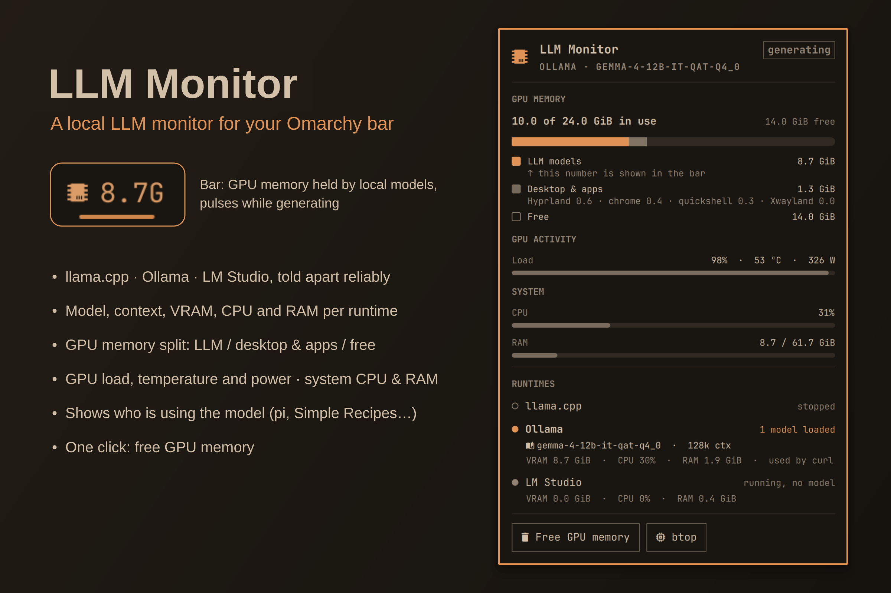

# LLM Monitor



**See at a glance when a local LLM is using your GPU, how much it holds, how full its context is, and who is using it.**

LLM Monitor is a small Omarchy bar widget for people who run local models with **llama.cpp**, **Ollama**, **LM Studio** or **vLLM**.

- **Bar indicator:** a chip icon. Dim while no model is loaded. While a model is resident it shows the GPU memory held by local models and how full the model's context is (e.g. `󰘚 18.0G 33%`), with a thin fill line underneath. It pulses while the GPU is generating. A `!` marks model memory that no longer fits in VRAM and was moved to system RAM.
- **Context colours:** the chip, its fill line and the panel's buffer bars turn **green** (below 50 %), **yellow** (50 %), **orange** (75 %) and **red** (90 %) as the context fills up, using the named colours of your current Omarchy theme. After your coding agent compacts the conversation, the level drops back with its next request.
- **Detail panel (left click):**
  - **GPU memory** as one stacked bar with a legend: *LLM models* (the number in the bar), *Desktop & apps* (with the programs behind it, e.g. Hyprland, browser) and *Free*, so the bar number never looks like a mismatch with the GPU total.
  - **Context buffer:** tokens in the context window (e.g. `33k / 98k tokens`) and the share of the reserved KV-cache memory they fill (`≈ 624 MiB of 1.8 GiB`).
  - **Output buffer:** tokens of the reply being generated against its limit (`max_tokens` or the model's `n-predict`), with the memory they occupy. The last reply stays visible after it ends.
  - **GPU activity:** load, temperature and power, plus the **generation speed** of the loaded model: live tokens per second while it writes, and min / avg / max over the replies since the monitor started watching (llama.cpp with `--metrics`, vLLM). The average is weighted by tokens.
  - **System:** CPU and RAM.
  - **Runtimes:** llama.cpp, Ollama, LM Studio and vLLM, each with state (not installed / stopped / running / model loaded / model sleeping), model name, context fill, VRAM, CPU, RAM and the programs currently connected (e.g. pi, Simple Recipes).
  - **Free GPU memory** button and a **btop** shortcut.
- **Right click:** opens btop.

## Languages and settings

The interface is built in in eight languages: English, German (Deutsch), French (Français), Spanish (Español), Italian (Italiano), Portuguese (Português), Dutch (Nederlands) and Polish (Polski). It follows the system language (`LC_ALL`, `LC_MESSAGES`, `LANG`) and falls back to English. To pick another one, open the **gear (⚙)** at the top right of the panel → **Language**. The translations ship with the plugin: nothing is downloaded or generated, and the plugin makes no extra requests for them. The choice is stored in the widget's own entry in `~/.config/omarchy/shell.json` (`"language"`); **System (…)** removes it again.

The settings page opens from the gear and closes with **← Back**, Backspace or Esc. Besides **Language** it has:

- **Corners:** *Like windows (… px)* (the default) follows Hyprland's window rounding (`decoration:rounding`, as the shell reads it), *Slightly rounded (6 px)*, *Rounded (12 px)* or *Square*. It rounds the panel's cards, buttons, drop-downs, the note field, meter tracks, legend swatches and switches (cards and pop-ups at the full radius, buttons, drop-downs and fields at most 8 px, tracks and swatches at most 4 px; switches and dots round, or square in *Square*). The panel's outer frame, its tool tips and the status pill in its header are drawn by the shell and keep the shell's rounding. Stored as `"corners"` in the widget's entry in `~/.config/omarchy/shell.json`; *Like windows* removes it again.
- **F12 saves a screenshot** (on by default; stored as `"screenshotKey": false` when switched off, see below).

### F12: a screenshot of the panel, with a note

While the panel is open, **F12** (without Ctrl, Shift, Alt or Super) saves a picture of the panel, for telling what is wrong with it, as in the author's GTK apps:

- **Only on F12.** Nothing is captured at any other time, and only the panel itself: Qt draws the panel's own content into the picture (`grabToImage`). No screen capture tool runs, nothing else on the screen is in it, and nothing is uploaded or sent anywhere.
- **Where:** `~/Pictures/LLM Monitor/llm-monitor-<date>-<time>.png` (the pictures folder from `~/.config/user-dirs.dirs` when it is set there). A panel then names the file and asks **What is wrong? (optional)**; **Enter** or **Done** saves the text next to the picture as a `.txt` with the same name (at most 4000 characters; no text, no file), **Esc** skips it, and closing the panel keeps what was typed.
- **Private files:** the folder is made `0700` when missing and only used when it is a real folder (not a link) of yours that no one else can write to; pictures and notes are new `0600` files, never written through a link or over an existing file (`-2`, `-3` … are added instead), and a picture that cannot be written completely is removed again.
- **How:** the panel first writes the picture into its own folder `$XDG_RUNTIME_DIR/ubruckhaus.llm-usage-shot/` (`0700`, in memory; used only when `$XDG_RUNTIME_DIR` itself is a real folder of yours that no one else can write to; a picture left there by a save that never ran is removed when the panel loads, or before the next screenshot, once it is two minutes old). `shot_save.py` (Python standard library) is then started with a fixed argument list, never through a shell: `cleanup <plugin id>` (when the panel loads), `prepare <plugin id>`, `save <picture> "LLM Monitor"` (checks that the picture is a regular file of yours in that folder, at most 32 MiB and a PNG, copies it as above and removes it), and `note <picture> "LLM Monitor"` with the note on its standard input. Each call answers with one line of JSON. A new F12 waits until the note before it is written.
- **Off:** switch **F12 saves a screenshot** off on the settings page; F12 then does nothing in this panel.

The **ⓘ** button beside the gear opens an **Information** page with a card for each of the author's other plugins in the Omarchy Plugin Marketplace, with a short description in the panel's language. A click on a card opens that plugin's marketplace page in the browser (a fixed `https://plugins.omarchy.org/plugin.html?id=…` address). The list comes from the marketplace's catalog, so newly published plugins of the author appear without a LLM Monitor update; a plugin this version does not know yet shows the first sentence of its marketplace description, in English (see *How it works*). **← Back**, Backspace or Esc returns.

## Install

Requires Omarchy Quattro's plugin-capable Quickshell and `python3` (standard library only, no extra packages). No setup script is needed.

```sh
omarchy plugin add https://github.com/uBruckhaus/omarchy-llm-usage
omarchy plugin enable ubruckhaus.llm-usage
```

GPU memory, load, temperature and power are read from the amdgpu sysfs and DRM `fdinfo` interfaces (AMD GPUs). On other GPUs the runtime and system information still works; GPU values may be missing.

## How it works

A collector (`scripts/llm-monitor.py`) runs while the widget is loaded and streams one snapshot every two seconds (about 1–2 % of one CPU core, ~25 MiB RAM).

- **Read-only by default.** It reads `/proc`, sysfs and the runtimes' local status endpoints on `127.0.0.1` (llama.cpp 8080, Ollama 11434, LM Studio 1234, vLLM 8000 or its `--port`) **only while that runtime is already running**. It never starts, stops or reconfigures a runtime by itself and sends nothing to the network; only the Information page reads the marketplace's plugin list (below).
- **Lets an idle model sleep.** llama.cpp's `--sleep-idle-seconds` frees the card only when no request comes in, and `/slots` and `/metrics` count as requests. A loaded llama.cpp model is therefore asked only while its process works (its CPU time grows) and once right after; an idle one is left alone and keeps its last figures, so it can go to sleep.
- **Information page (ⓘ):** the only request outside your computer and LAN. Started only when the page is shown (a request in progress finishes even if you leave the page), `plugin_catalog.py` reads the marketplace's catalog `https://raw.githubusercontent.com/omacom/omarchy-plugin-marketplace/main/site/catalog.json` with `curl --proto =https --max-redirs 0` (at most 40 MiB and 40 s, and with the last `ETag`, so an unchanged catalog is not downloaded again; a list cached before this version, when only `github.com/ubruckhaus` counted, is read once more in full without it), at most once an hour per panel, failed attempts included (kept on disk, and by the panel itself while the shell runs; two panels opened in the same moment may each ask once). Only the author's own entries (repositories under `github.com/ubruckhaus` or `github.com/maprisma`, at most 60) are kept, as id, name, version, description text and the verified flag, with the time of the last check and the `ETag`, in `~/.cache/ubruckhaus.llm-usage/plugin-catalog.json` (the folder must be yours, not a link and closed to others — it is made `0700` if missing, otherwise nothing is read or written; file `0600`, written atomically inside that folder; read back only as a regular file of yours, at most 1 MiB). No model names, usage statistics, process information or other local data are sent; GitHub sees the usual request details (your public IP address, the fixed user agent and the `ETag`). Offline, the cached list or the built-in one is shown.
- **Runtimes are told apart by systemd unit and executable path**, because Ollama and LM Studio both ship an engine named `llama-server`.
- **One-shot llama.cpp tools** (`llama-tts`, `llama-cli`, `llama-mtmd-cli`, ...) count as llama.cpp while they run, e.g. Simple Reader's Qwen voices. They have no HTTP API, so they show the model, VRAM, CPU, RAM and the program that started them, but no context or output buffers.
- **GPU memory per runtime** comes from DRM `fdinfo` (`drm-resident-vram`), so only memory that is really in VRAM is counted; requested-but-evicted memory is reported separately.
- **Context and output buffers.** llama.cpp: tokens from `/slots`, with the context counted once when the slots share a unified KV cache (llama.cpp's default when the number of slots is automatic) and added up when each slot has its own part; the KV-cache size is projected once per model load with `llama-fit-params` from the same llama.cpp build (CPU only, nothing is loaded onto the GPU; only when util-linux `setpriv` is installed: it runs under `setpriv --pdeathsig KILL`, so it ends with the collector, and stopped by the collector when the widget unloads). vLLM: KV-cache fill from `/metrics` (`kv_cache_usage_perc`, pool size from `cache_config_info`); vLLM does not report a per-reply output limit, so it has no output-buffer row. Ollama and LM Studio report only the configured context size.
- **Replies are checked, not trusted.** Whatever answers on a runtime's port is size- and time-limited; numbers have to be finite and in range (a reply with `NaN`, `Infinity` or an overflowing `1e999` counts as no reply), so every snapshot stays valid JSON.
- **Installed or not** is checked about once a minute (command on `PATH`, systemd unit, LM Studio's `~/.lmstudio`, or the `vllm` Python package), so a runtime you never installed shows *not installed* instead of *stopped*.

### Free GPU memory (the only action that changes runtime state)

Only when you click **Free GPU memory**, `scripts/free-gpu.sh` runs:

- `systemctl --user stop llama-server.service ollama.service vllm.service` (user units only, no root),
- `lms unload --all` if the LM Studio daemon is running (its daemon keeps running).

This stops those local AI services for every program using them at that moment. A notification says what was stopped, what could not be stopped, which services could not be checked (e.g. when `systemctl --user` cannot reach the user session), or that nothing was running (a server started by hand has to be stopped where it runs).

## Update or remove

```sh
omarchy plugin update ubruckhaus.llm-usage
```

```sh
omarchy plugin disable ubruckhaus.llm-usage
omarchy plugin remove ubruckhaus.llm-usage
```

The plugin creates no services or settings outside its own folder. The Information page's plugin list is cached in `~/.cache/ubruckhaus.llm-usage/`; delete that folder too if you like (it is only a cache). Screenshots you took with F12 stay in `~/Pictures/LLM Monitor/` until you delete them.

## Development

```sh
python3 scripts/llm-monitor.py --once | python3 -m json.tool
python3 -m unittest discover -s tests
omarchy plugin validate .
```

`PanelShot.qml`, `shot_save.py` (with `tests/test_shot_save.py`), `corners.js`, `KeyTextField.qml`, `CompactDropdown.qml`, `MorePlugins.qml` and the shared texts in `I18n.js` come from the author's shared plugin kit and are the same in his other panels.

`preview.png` is a composed screenshot of the real panel while llama.cpp was generating for a coding agent (see `PREVIEW.md`).

Licensed under [MIT](LICENSE).
